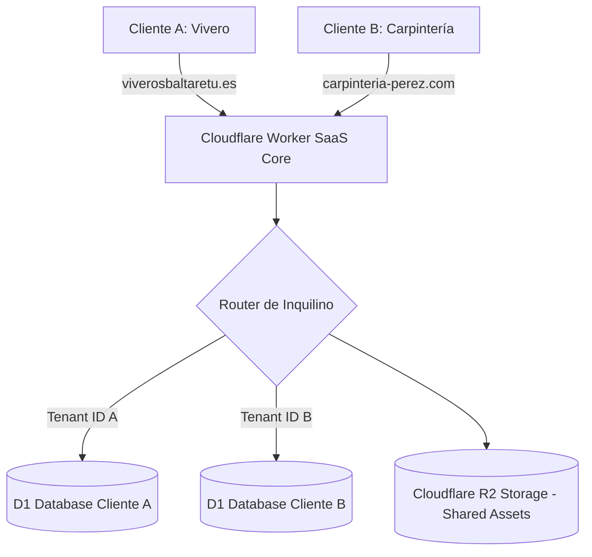

# 02. Opciones Técnicas y Recomendaciones

**Fecha:** 15 de octubre de 2026
**Autor:** Arquitecto de Software Senior (Evaluación Independiente)
**Proyecto:** Viveros Baltaretu → Plataforma SaaS Multicliente

---

## 1. Evaluación por Decisión de Arquitectura

### B1. Modelo Multicliente

| Opción | Descripción | Ventajas | Inconvenientes | Coste (5 / 10 / 50 clientes) | Recomendación |
|---|---|---|---|---|---|
| **A. Single-tenant (1 app/DB por cliente)** | Un Worker y una DB D1 dedicada por cliente. | Aislamiento 100% físico, cero riesgo de fugas entre datos. | N despliegues, mantenimiento alto, escalado de configuración en Cloudflare. | 0 € / 5 € / 25 € al mes (Cloudflare Workers Paid si pasa de 100k req/día). | **RECOMENDADA (Híbrido)** para fase inicial (1-10 clientes). |
| **B. Multi-tenant puro (DB compartida con `tenant_id`)** | Un único Worker y DB D1 compartida con columna `tenant_id`. | Un solo despliegue, altas instantáneas, fácil analítica global. | Riesgo de fuga de datos por bug de código (IDOR/BOLA), límites de D1 (10 GB por DB). | 0 € / 5 € / 5 € al mes (1 solo Worker Paid). | Para fase de escala (> 50 clientes). |
| **C. Híbrido (Multi-tenant de código, DB D1 aislada por cliente)** | Un mismo código/Worker que enruta según el hostname (`Host: cliente.com`) a la DB D1 del cliente. | Aislamiento estricto de DB por cliente sin duplicar el código del Worker. | Configuración de bindings en `wrangler.jsonc` dinámica o enrutamiento por ID de DB. | 0 € / 5 € / 15 € al mes. | **RECOMENDACIÓN FINAL**. |

---

### B2. Organización del Código

| Opción | Descripción | Ventajas | Inconvenientes | Recomendación |
|---|---|---|---|---|
| **A. Repositorio por cliente** | Clonar el repo actual para cada cliente nuevo. | Personalización total sin límites. | Divergencia instantánea del código. Imposible actualizar 50 repos por 1 sola persona. | **DESCARTADA**. |
| **B. Núcleo reutilizable con Configuración (Single Monorepo)** | Un solo repositorio con el núcleo Astro + Panel, y archivos de configuración / schemas por sector. | Actualizaciones globales inmediatas (`git push main`), cero divergencia de código base. | Requiere abstraer el catálogo e inventario. | **RECOMENDADA**. |
| **C. Monorepo (pnpm/turborepo con apps/)** | Apps separadas por cliente compartiendo paquetes (`packages/ui`, `packages/core`). | Separación limpia de paquetes. | Excesiva complejidad de build para 1 solo desarrollador. | **DESCARTADA**. |

---

### B3. Base de Datos y Almacenamiento (Fotos y Archivos)

- **Motor recomendado:** **Cloudflare D1** (SQLite distribuido) con 1 base de datos aislada por cliente (o esquema segregado).
- **Almacenamiento de fotos/tickets:** **Migrar de D1 BLOB a Cloudflare R2** (`bucket` de objetos S3 compatible).
  - *Razones:* R2 ofrece 10 GB gratis y cuesta 0,015 $/GB al mes sin costes de egreso (bandwidth libre). Guardar BLOBs en D1 es un antipatrón que satura la base de datos SQL.
- **Copias de seguridad:** Pipeline automatizado mediante exportación diaria de D1 a R2 en formato SQL dump (`wrangler d1 export`).
- **Exportación de datos (Lock-in zero):** Botón en el panel del cliente para descargar en 1-click su base completa en SQLite + ZIP con sus fotos en R2.

---

### B4. Alojamiento, Despliegue y Dominios

- **Alojamiento:** Cloudflare Workers + Static Assets (manteniendo el stack actual).
- **Dominios y Certificados:** Utilizar **Cloudflare for Platforms (Custom Domains)**. Permite a los clientes vincular su propio dominio (`ejemplo.com`) mediante CNAME apuntando al Worker principal, con SSL gestionado automáticamente por Cloudflare vía API.
- **Alta de clientes:** Script CLI de provisionamiento (`scripts/plataforma/alta-cliente.ts`) que ejecuta:
  1. Creación de DB D1 en Cloudflare vía API.
  2. Ejecución de migraciones iniciales.
  3. Registro del dominio en Cloudflare for Platforms.
  4. Inserción del usuario propietario inicial.

---

### B5. Autenticación y Roles

| Opción | Descripción | Coste | Seguridad | Recomendación |
|---|---|---|---|---|
| **A. Cloudflare Access (Actual)** | Requiere configurar reglas de Access por dominio/cliente. | 0 € (< 50 usuarios). | Muy alta (Zero Trust JWT). | Complejo para clientes no técnicos. |
| **B. Auth propio con Magic Link / Passkeys (WebAuthn) en D1** | Sistema nativo en el Worker usando `jose` JWT + envío de código/magic link por email. | 0 € (Coste del transaccional). | Alta y amigable para el usuario final. | **RECOMENDADA**. |
| **C. Auth0 / Clerk / Stytch** | Proveedores de Auth SaaS externos. | Gratis hasta 10k MAU, luego 25-99 $/mes. | Máxima. | Costoso a escala y añade dependencia externa. | **DESCARTADA**. |

---

### B6. Personalización Visual y Temas

- **Estrategia:** Tailwind CSS v4 con variables CSS dinámicas inyectadas desde la configuración del cliente en D1 (`theme.config`).
- **Esquema de color:** El servidor inyecta en el `<head>` del layout las variables CSS del cliente (`--color-marca`, `--color-acento`, `--color-fondo`).
- **Logos y Favicons:** Servidos dinámicamente desde Cloudflare R2 según el dominio activo (`/assets/logo.png`).
- **Plantillas de Layout:** 2 plantillas base configurables (Plantilla A: *Catálogo con Filtros Avanzados*; Plantilla B: *Showroom / Servicios con Solicitud de Presupuesto*).

---

### B7. Módulos y Planes de Suscripción

- **Tabla de Flags de Módulo (`tenant_modules`):**
  - `web_catalogo` (Básico - 29 €/mes)
  - `presupuestos_online` (Básico - 29 €/mes)
  - `facturacion_verifactu` (Profesional - 59 €/mes)
  - `asistente_ia` (Premium - 89 €/mes)
  - `gestion_gastos_vision` (Premium - 89 €/mes)
- **Control en Runtime:** El middleware y la capa de navegación (`navegacion.ts`) filtran las rutas y menús del panel consultando los módulos activos del cliente en tiempo de ejecución.

---

### B8. Asistente de IA (AgricolAI → Asistente Genérico Multicliente)

- **Aislamiento de Prompts:** `instrucciones.ts` parametrizado con el sector y glosario del cliente (ej. `sector: "carpinteria"`, `unidades: "metros lineales"`).
- **Herramientas de IA Dinámicas:** Las 26 herramientas actuales se refactorizan para operar sobre entidades genéricas (`items` de catálogo en lugar de `plantas`).
- **Control de Cuotas y Costes:**
  - Límite diario configurable por plan (ej. Plan Premium: 100 peticiones IA/día).
  - Respaldo automático a motor local por reglas o fallback a Groq/OpenAI si se sobrepasa el cupo gratuito de Workers AI.

---

### B9. Facturación con VeriFactu (Obligación Legal R.D. 1007/2023)

- **Análisis de Opciones:**
  1. *Desarrollo propio del módulo VeriFactu completo:* Requiere firma electrónica XML XAdES, encadenamiento estricto, generación de QR con formato especifico de la AEAT, conectividad directa webservice AEAT y firmar como desarrollador una **Declaración Responsable de Cumplimiento Legal**. Riesgo jurídico alto y ~150 horas de trabajo.
  2. *Integración con API VeriFactu de terceros (ej. Factura Directa / Cuéntica / VeriFactuAPI / Facturae API):* API certificada que asume la responsabilidad de comunicación con la AEAT. Coste ~0,05 € a 0,15 € por factura.
- **Recomendación:** **Integrar una API VeriFactu de terceros**. El coste por factura se repercute directamente en el plan del cliente o como addon (10 €/mes). Esto elimina la responsabilidad legal del propietario sobre la certificación del software de facturación.

---

### B10. Cobro de Suscripciones (Stripe Billing)

- **Pasarela:** **Stripe Billing / Customer Portal**.
- **Flujo automatizado:**
  - El cliente se registra en la web principal de la plataforma SaaS y selecciona un plan.
  - Stripe Checkout procesa el pago del primer mes.
  - Webhook de Stripe (`customer.subscription.created`) invoca la API de provisionamiento de la plataforma para dar de alta al cliente en Cloudflare en < 30 segundos.
  - Gestión de impagos/bajas automática vía webhooks de Stripe (desactiva el acceso al panel si la suscripción se cancela).

---

### B11. Operación, Monitorización y Soporte

- **Monitorización:** Cloudflare Web Analytics + Cloudflare Worker Trace Logs (gratuito).
- **Avisos de Caídas/Errores:** Bot de Telegram / Discord mediante Webhook de alertas de Cloudflare Workers (0 €).
- **Plan de Continuidad:** Exportación nocturna de datos a R2 + posibilidad de migrar Workers a cualquier entorno Node.js/Bun (el código usa estándares web Fetch/Request/Response).

---

### B12. Evaluación Global del Stack Tecnológico

- **¿Conviene cambiar de tecnología (ej. migrar a Next.js / Laravel / Supabase)?**
  - **Dictamen:** **NO**. El stack actual (**Astro + Cloudflare Workers + D1 + Tailwind CSS**) es extremadamente sólido, tiene 0 € de coste fijo base, ofrece un rendimiento inigualable (páginas estáticas renderizadas en el Edge con prerenderizado estático) y los tiempos de respuesta del Worker son < 20 ms.
  - Cambiar de stack implicaría rehacer 214 tests en verde, perder la arquitectura estática de velocidad ultrarrápida y asumir costes de servidores dedicados (Vercel/AWS/Render) de al menos 20-50 €/mes desde el primer día.

---

## 2. Modelo de Costes de Infraestructura (5, 10 y 50 Clientes)

| Servicio | Proveedor | 5 Clientes | 10 Clientes | 50 Clientes |
|---|---|---|---|---|
| **Alojamiento Worker + SSL** | Cloudflare Workers Paid | 5,00 $ / mes | 5,00 $ / mes | 5,00 $ / mes |
| **Base de Datos (D1)** | Cloudflare D1 | 0,00 $ (Incluido en Workers Paid) | 0,00 $ | 1,00 $ / mes (exceso lecturas) |
| **Fotos y Archivos (R2)** | Cloudflare R2 | 0,00 $ (< 10 GB) | 0,15 $ / mes | 1,50 $ / mes (100 GB) |
| **Asistente IA** | Workers AI (Gratis) / Groq | 0,00 $ | 0,00 $ | 5,00 $ / mes |
| **API VeriFactu** | API Terceros | Repercutido al cliente | Repercutido al cliente | Repercutido al cliente |
| **Email Transaccional** | Resend / Cloudflare Email | 0,00 $ (< 3.000 emails/mes) | 0,00 $ | 15,00 $ / mes |
| **Cobro Suscripciones** | Stripe (2.9% + 0,30€) | Variable (~5 €) | Variable (~15 €) | Variable (~75 €) |
| **TOTAL ESTIMADO INFRAESTRUCTURA** | | **5,00 $ / mes** | **5,15 $ / mes** | **27,50 $ / mes** |

### Ingresos Brutos Estimados vs Costes
- **5 Clientes (Promedio 49 €/mes):** Ingresos = 245 €/mes | Coste infra = ~5 € | **Margen = 98%**
- **10 Clientes (Promedio 49 €/mes):** Ingresos = 490 €/mes | Coste infra = ~6 € | **Margen = 98.7%**
- **50 Clientes (Promedio 49 €/mes):** Ingresos = 2.450 €/mes | Coste infra = ~28 € | **Margen = 98.8%**
